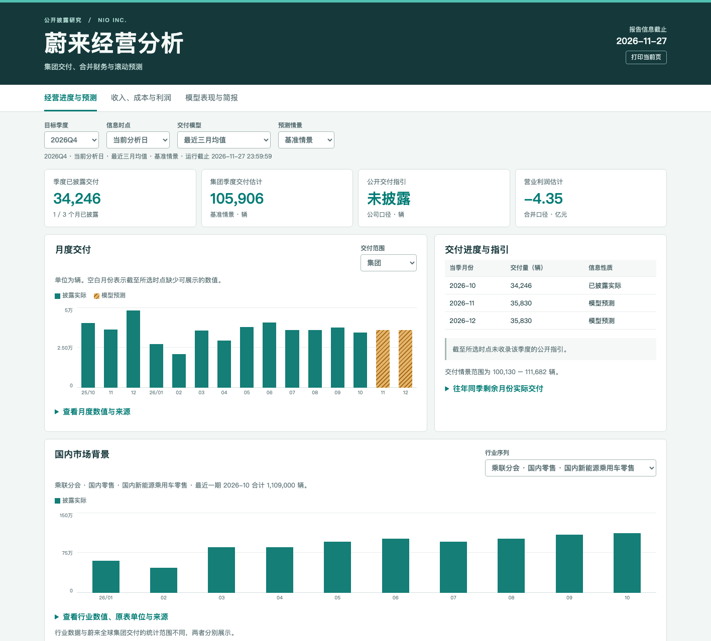

# 蔚来经营预测与利润差异分析

季度结束后，交付量往往先于财报公布。这项个人公开数据研究重建每次公告后的信息集，预测集团交付、收入、毛利及营业利润，并在财报公布后把误差拆到八个经营变量。所有金额均为人民币，财务数据采用蔚来集团合并美国会计准则口径。

**资料截止 2026 年 11 月 27 日。** [阅读一页经营简报](reports/example/brief.md) · [查看二季度营业利润复盘](reports/profit-review.md) · [下载离线交互看板](https://github.com/leoncrab/nio-business-analysis/raw/refs/heads/main/reports/example/dashboard.html)



## 截至该日能回答什么

| 集团指标 | 2026Q3 | 2026Q4 |
|---|---:|---:|
| 季度交付 | **109,178 辆，已披露** | **105,906 辆，个人基准预测** |
| 营业收入 · 个人基准预测 | 325.47 亿元 | 316.64 亿元 |
| 营业利润 · 个人基准预测 | −2.71 亿元 | −4.35 亿元 |
| 营业利润 · 偏弱至偏强情景 | −16.43 至 +11.01 亿元 | −19.82 至 +12.57 亿元 |

四季度只观察到 10 月的 34,246 辆。基准将此前最近三个已披露月份的平均交付量用于 11、12 月，再沿用最新已披露季度的单位车辆收入、单位车辆成本及其他经营项目。情景幅度取自当时可见的历史波动，受配置上限约束。它表达经营假设的敏感性；统计覆盖概率需另行校准。

二季度提供了一个已能核实的利润案例。毛利比一季度增加 **10.47 亿元**，同期研发与销管费用增加 **11.87 亿元**。计入其他经营收益后，营业亏损扩大 **3,840.8 万元**。案例列出五项会计贡献、八项驱动分解、管理层解释与仍待验证的问题。[财报复盘和复算代码](reports/profit-review.md)

## 本地运行

下载整个仓库后，在项目根目录运行。核心流程使用 Python 3.10+ 标准库及 SQLite，数据和页面资源随仓库提供。Windows 如果缺少 IANA 时区数据库，先安装 `tzdata`。

```bash
python3 -m nio --as-of 2026-11-27
python3 -m unittest discover -s tests -v
```

第一条命令打印本次归档目录。用现代 Chrome、Edge、Firefox 或 Safari 打开其中的 `dashboard.html`；页面在本地解压数据，支持离线筛选和打印。要快速查看已生成的版本，可直接下载上方看板链接。GitHub 文件页展示源码，下载后打开即可交互。

| 运行结果 | 用途 |
|---|---|
| `build/nio.sqlite` | 查询来源、字典、月实际、季实际、公司指引、冻结预测、假设和计算事实 |
| `build/latest.txt` | 最近一次成功生成的报告目录名 |
| `build/日期-内容摘要/dashboard.html` | 交付进度与预测、利润分解、模型表现与简报三页看板 |
| 同目录 `analysis.json` | 全部模型、情景、原始输入编号、历史成绩、失效案例和贡献表 |
| 同目录 `facts.json`、`brief.md`、`draft.json`、`review.json` | 事实包、简报、原稿和规则审核记录 |

## 数据及口径

| 序列 | 覆盖范围 | 核验材料 |
|---|---|---|
| 全球集团交付 | 2021-01 至 2026-10，70 个连续月份；品牌明细按已披露期间保留 | [按月公告与校验值](data/monthly_sources.csv) |
| 集团季度财务 | 2021Q1 至 2026Q2，22 个季度，每期 12 项；2021 年前三季按后续比较列的实际披露时间进入模型 | [财报和指引公告](data/finance_sources.csv) |
| 公司公开指引 | 交付和收入分别记录，保留后续修订。约数指引按点值比较 | [上下界、目标期和原文位置](data/guidance.csv) |
| 国内乘用车市场 | 2026 年 1–10 月的乘用车零售、新能源乘用车零售、厂商批发 | [乘联分会原文、原始单位和采集定位](data/monthly.csv) |

全国整车市场另收录中汽协口径的 2026 年前十个月产量、销量及新能源分项，共 40 条。归档为关键数字摘录，4 月采用注明工信部来源的转载，5–6 月采用工信部装备工业发展中心资料。[全国汽车工业来源和披露时间](data/industry_sources.csv)

前 14 个月的交付取自蔚来 IR 的关键行摘录，其 SHA-256 对应仓库保存的摘录文件。此后的 56 个月保存港交所 PDF 原件。2025 年 4 月单独披露的品牌数量不齐，保留缺项。全球集团交付与国内零售、批发使用独立范围代码。公司没有披露的订单、品牌利润和渠道成本不作估计。

仓库保留原始金额及单位，模型统一使用元、辆。收入、成本和期间按科目核对，成本与费用按原表列示符号转换，其他经营收益保留正负。单车收入和单车成本为会计金额与同期交付的比值，受到结构和确认时点影响。[指标字典](config/metrics.json) · [SQL 表与分析视图](sql/schema.sql)

## 如何重建一次历史预测

1. 按上海时区解释命令行日期，截至该日 23:59:59。原公告精确到秒时使用原时间，精确到分钟时从下一分钟可用，只有日期时从来源时区次日零点可用。数据库用 UTC epoch 比较。
2. 对每项指标选当时已公开的最新版本。每次预测冻结运行编号、来源文件哈希、输入记录、模型版本、参数和情景。历史回放是今天按旧信息集重建的模拟预测。
3. 季度开始时生成 T0，首月、次月、末月交付披露后依次生成 T1–T3。T3 的交付已知，只评价随后公布的财务。Live 单列当前季度和已结束但仍缺财务的上一季度。
4. 在相同时点比较近三月均值、上年同月和近期同比调整三种方法。财务驱动参考最新可比季度。对称利润桥分解交付量、单位收入、单位成本、其他收入、其他成本、研发、销管及其他经营收益；数值残差容差为人民币 0.01 元。[模型与公式](nio/model.py) · [情景配置](config/scenarios.json)

2024–2025 年作为开发窗口，2026 年已能评价的季度单列。按 T1 的集团交付衡量，三种模型在相同的三个 2026 年季度上，WAPE 分别为 **14.06%、21.77%、14.95%**。营业利润以金额误差和盈亏方向评价。样本很短，且验证安排是事后设定，结果仅用于回顾。逐季误差、实际是否落入情景范围和候选模型落后基准的案例均可在看板第三页查看。

## 数据更新和简报审核

把新的披露文件保存在新的版本路径，登记披露日期、原始时区、定位和 SHA-256。月度清单见 `data/monthly_sources.csv`；财务原件与版式索引见 `data/raw/financials/releases.json`。更新时先查看新公告表头、币种、期间和单位，再执行离线提取：

```bash
python3 -m pip install -r requirements.txt
python3 scripts/monthly_extract.py
python3 scripts/finance_extract.py
python3 scripts/industry_extract.py
python3 -m nio --as-of 2026-11-27
```

把最后一行的日期换成实际分析日。处理脚本会校验存档哈希、单位和范围、财务等式及季度交付，遇到冲突时停止。修订使用新的来源编号；旧公告、旧运行和旧报告可继续追溯。

简报默认使用已核验事实生成。外部 AI 可提交结构化事实选择，数字、期间和单位由程序填入；遇到无效引用则回退至模板并保留原稿。已发布示例是模板输出，人工复核状态为待审核。[简报输入、核验和人工复核流程](reports/brief-workflow.md)
